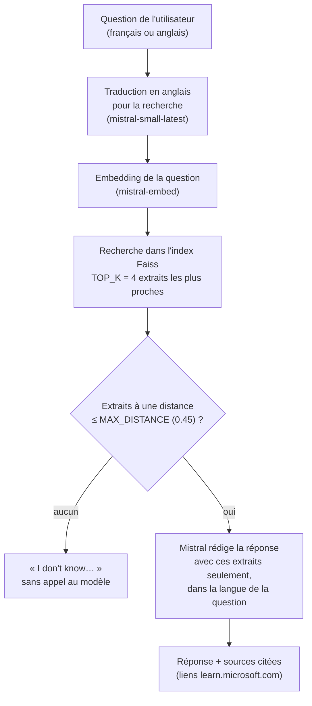
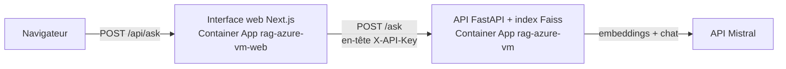

# RAG Azure VM

Un assistant qui répond aux questions sur les machines virtuelles Azure à partir de la documentation officielle de Microsoft, en citant les pages d'où vient la réponse.

Projet personnel d'apprentissage : j'ai construit toute la chaîne, de l'indexation de la documentation jusqu'à une interface web déployée sur Azure.

**Démo en ligne : https://rag-azure-vm-web.proudsea-0a9f34b1.francecentral.azurecontainerapps.io**

> L'application s'arrête quand personne ne s'en sert. La première question la réveille, ce qui prend environ 20 secondes en plus du temps de réponse. Les suivantes sont plus rapides.

<!--
  Capture d'écran ou GIF de la démo : enregistrer le fichier dans docs/
  puis remplacer ce commentaire par la ligne suivante.
  
-->

## Ce que fait le projet

On pose une question en français ou en anglais, par exemple « Comment corriger l'erreur DiskRestorePointUsedByCustomer quand je supprime un point de restauration ? ». L'assistant cherche les passages utiles parmi les 1 220 pages de la documentation Azure Virtual Machines, puis rédige une réponse courte et pratique, avec les liens vers les pages de Microsoft qui la justifient.

Si la documentation ne couvre pas la question (le prix d'Azure SQL, par exemple), il le dit au lieu d'inventer une réponse.

## Fonctionnement

C'est un RAG (*Retrieval-Augmented Generation*) : on retrouve d'abord les bons passages de la documentation, puis on demande au modèle de langage de répondre en s'appuyant uniquement sur eux.



Les étapes, dans [`rag.py`](rag.py) :

1. **Traduction pour la recherche.** La documentation est en anglais. Une question en français était trop éloignée des textes dans l'index et l'assistant refusait d'y répondre. La question est donc traduite en anglais, mot à mot, pour la recherche seulement. Le modèle reçoit ensuite la question d'origine et répond dans sa langue.
2. **Recherche.** Faiss renvoie les 4 extraits les plus proches de la question (`TOP_K`).
3. **Filtre de pertinence.** Les extraits trop éloignés (`MAX_DISTANCE = 0.45`) sont écartés. S'il n'en reste aucun, l'API répond qu'elle ne sait pas, sans appeler le modèle. J'ai choisi ce seuil en regardant les distances des bons et des mauvais extraits sur le jeu de test (`python evaluate.py --scores`).
4. **Réponse.** `mistral-small-latest`, à température 0, répond uniquement avec le contexte fourni et cite ses sources (`[1]`, `[2]`).
5. **Sources.** Seules les pages réellement citées dans la réponse sont renvoyées, une fois chacune. Si le modèle dit ne pas savoir, aucune source n'est renvoyée.

L'indexation se fait une seule fois, dans [`ingest.py`](ingest.py) : lecture des fichiers Markdown, suppression de l'en-tête YAML (le titre est gardé pour les citations), découpage en extraits de 1 000 caractères avec 150 caractères de recouvrement, calcul des embeddings par lots avec reprise automatique en cas de limite de débit, puis sauvegarde de l'index Faiss. Le corpus complet donne 14 297 extraits.

## Stack

| Partie | Outils |
|---|---|
| Pipeline RAG | Python 3.12, LangChain 1.x, Faiss (`faiss-cpu`) |
| Modèles | Mistral : `mistral-embed` (embeddings, dimension 1024) et `mistral-small-latest` (traduction et réponse) |
| API | FastAPI, Pydantic, uvicorn |
| Interface web | Next.js 16 (App Router), React 19, TypeScript strict, CSS simple, `react-markdown` |
| Tests | pytest, `TestClient` de FastAPI |
| Déploiement | Docker, GitHub Container Registry, Azure Container Apps, Azure CLI |

## Architecture



- **API** ([`api.py`](api.py)) : `POST /ask` reçoit `{"question": "..."}` (3 à 500 caractères) et renvoie `{"answer": "...", "sources": [{"title", "source", "url"}]}`. `GET /health` reste public. Quand la variable `API_KEY` est définie, `POST /ask` exige l'en-tête `X-API-Key`, comparé en temps constant, et répond 401 sinon. L'index Faiss et les clients Mistral sont chargés une seule fois, au démarrage.
- **Interface web** ([`web/`](web/)) : le navigateur n'appelle jamais l'API directement. Il passe par la route serveur [`web/app/api/ask/route.ts`](web/app/api/ask/route.ts), qui vérifie la question, ajoute la clé et appelle l'API. La clé reste donc sur le serveur et n'arrive jamais dans le navigateur. La page affiche la réponse en Markdown, les liens vers les sources, des exemples de questions et un thème clair ou sombre. L'interface est en français.
- **Deux Container Apps** dans le même environnement Azure (francecentral), chacune avec 0 à 1 réplica : elles s'arrêtent quand personne ne s'en sert, ce qui ne coûte rien, et redémarrent à la première requête.

## Déploiement

- **API** : le [`Dockerfile`](Dockerfile) part de `python:3.12-slim`, installe les dépendances, copie le code et l'index Faiss déjà construit (aucun calcul d'embedding au démarrage) et lance uvicorn avec un utilisateur non root. Le fichier `.env` n'entre jamais dans l'image. L'image est publiée sur `ghcr.io`, puis [`deploy.sh`](deploy.sh) crée la Container App (0,5 vCPU, 1 Gio) à partir des noms de ressources de [`deploy.env`](deploy.env). Le script lit `MISTRAL_API_KEY` et `API_KEY` dans `.env` et les enregistre comme secrets Container Apps, sans les afficher.
- **Interface web** : le [`web/Dockerfile`](web/Dockerfile) construit l'application en deux étapes et ne garde que la sortie *standalone* de Next.js, lancée avec l'utilisateur `node`. La Container App (0,25 vCPU, 0,5 Gio) reçoit l'adresse de l'API en variable d'environnement et la clé en secret.

## Évaluation

Les tests unitaires vérifient que le code fonctionne. Ils ne disent pas si les réponses sont bonnes. Pour ça, j'ai écrit un jeu de référence de 16 questions ([`evaluation/qa_reference.json`](evaluation/qa_reference.json)), dont 5 en français :

- 12 questions couvertes par la documentation. Pour chacune, la réponse doit citer au moins une des pages attendues, ne pas être un refus et contenir des mots-clés précis (par exemple `nouuid` pour l'erreur d'UUID en double sur XFS) ;
- 4 questions hors sujet (prix d'Azure SQL, contrôleur NGINX sur AKS), en anglais et en français. L'assistant doit refuser de répondre et ne renvoyer aucune source.

[`evaluate.py`](evaluate.py) envoie chaque question au vrai pipeline et calcule le score.

**Résultat : 16/16.**

Cette évaluation m'a servi à trancher entre deux approches. J'ai d'abord essayé de faire réécrire les questions par le modèle, en plus court, avant la recherche : le score est tombé à 11/16 et des questions en anglais qui passaient avant ont échoué, car la réécriture perdait des détails. J'ai donc gardé une traduction fidèle, sans réécriture.

Il faut lire ce score avec prudence : 16 questions, c'est peu, je les ai écrites moi-même, et la vérification par mots-clés ne juge pas toute la qualité d'une réponse.

## Limites connues

- **Périmètre** : seule la documentation Azure Virtual Machines est indexée, dans une copie figée. Elle ne se met pas à jour quand Microsoft modifie ses pages.
- **Liens approximatifs** : l'URL de chaque source est reconstruite à partir du chemin du fichier. Elle est juste pour la plupart des articles, mais pas pour les fichiers du dossier `includes/`, qui n'ont pas de page publique.
- **Démarrage à froid** : environ 20 secondes d'attente quand l'application dormait.
- **Une question à la fois** : l'assistant ne garde pas l'historique de la conversation.
- **Coût et latence** : chaque question coûte un embedding et deux appels au modèle (traduction, puis réponse).
- **Démo ouverte** : la démo est publique et ne limite pas encore le nombre de questions par visiteur. Seul le plafond de dépassement du compte Mistral protège le budget.
- **Évaluation limitée** : voir la section précédente. Elle se lance à la main, il n'y a pas d'intégration continue.

## Lancer le projet en local

Les commandes sont pour Git Bash sur Windows. Il faut Python 3.12, Node.js et une clé d'API Mistral.

### 1. Environnement Python

```bash
git clone https://github.com/FaridAmimri/rag-azure-vm.git
cd rag-azure-vm
python -m venv .venv
source .venv/Scripts/activate
pip install -r requirements.txt
```

### 2. Clés

Créer un fichier `.env` à la racine (il est ignoré par Git) :

```bash
MISTRAL_API_KEY=votre_cle_mistral
API_KEY=une_cle_de_votre_choix
```

`API_KEY` est facultative pour l'API seule. L'interface web en a besoin, car elle envoie toujours une clé.

### 3. Corpus

Le corpus n'est pas dans le dépôt. On récupère seulement le dossier `articles/virtual-machines` du dépôt de Microsoft :

```bash
git clone --depth 1 --filter=blob:none --sparse https://github.com/MicrosoftDocs/azure-compute-docs.git ../azure-compute-docs
git -C ../azure-compute-docs sparse-checkout set articles/virtual-machines
mkdir -p data
cp -r ../azure-compute-docs/articles/virtual-machines data/
```

### 4. Index Faiss

```bash
python ingest.py          # sous-ensemble de développement : les 14 fichiers « troubleshoot »
python ingest.py --full   # corpus complet : environ 1 220 fichiers
```

Le calcul des embeddings appelle l'API Mistral et consomme du crédit : le sous-ensemble suffit pour tester.

### 5. API

```bash
python rag.py "Creating a restore point fails, how can I fix it?"   # une question en ligne de commande (appelle Mistral)
uvicorn api:app --reload
```

La documentation interactive de l'API est sur http://127.0.0.1:8000/docs.

### 6. Interface web

Dans un second terminal, créer `web/.env.local` :

```bash
RAG_API_URL=http://127.0.0.1:8000
RAG_API_KEY=la_meme_valeur_que_API_KEY
```

Puis :

```bash
cd web
npm install
npm run dev
```

Ouvrir http://localhost:3000 (pas l'adresse « Network » affichée par Next.js : il y bloque ses ressources de développement et le formulaire ne fonctionne pas).

### 7. Tests

```bash
pytest -v            # tests unitaires : Mistral et Faiss sont simulés, aucun coût
python evaluate.py   # évaluation sur le vrai pipeline : appelle Mistral, environ 3 appels par question
```

## Ce que j'ai appris

- Construire un pipeline RAG complet avec LangChain 1.x : chargement, découpage, embeddings, index vectoriel, prompt et chaîne LCEL.
- Mesurer la qualité des réponses avec un jeu de référence, et laisser les chiffres décider : choix du seuil `MAX_DISTANCE`, abandon de la réécriture des questions.
- Faire dire « je ne sais pas » au modèle plutôt que de le laisser inventer, et vérifier ce comportement dans l'évaluation.
- Gérer les limites de débit d'une API payante (lots, pauses, nouvelles tentatives) et travailler avec un budget serré.
- Écrire une API FastAPI validée par Pydantic et la tester sans appeler de service externe, en remplaçant les dépendances par des fausses.
- Protéger une clé d'API : secret Container Apps, en-tête `X-API-Key`, appel côté serveur depuis Next.js.
- Conteneuriser deux applications (images légères, utilisateur non root, aucun secret dans l'image) et les déployer sur Azure Container Apps avec mise en veille automatique.

## Crédits

Le corpus provient de la documentation Azure Virtual Machines de Microsoft, dépôt [MicrosoftDocs/azure-compute-docs](https://github.com/MicrosoftDocs/azure-compute-docs) (dossier `articles/virtual-machines`), publiée sous licence [Creative Commons Attribution 4.0 International (CC-BY-4.0)](https://creativecommons.org/licenses/by/4.0/). Le corpus n'est pas inclus dans ce dépôt : il est téléchargé en local et sert seulement à construire l'index. Ce projet n'est ni affilié à Microsoft ni approuvé par Microsoft.
